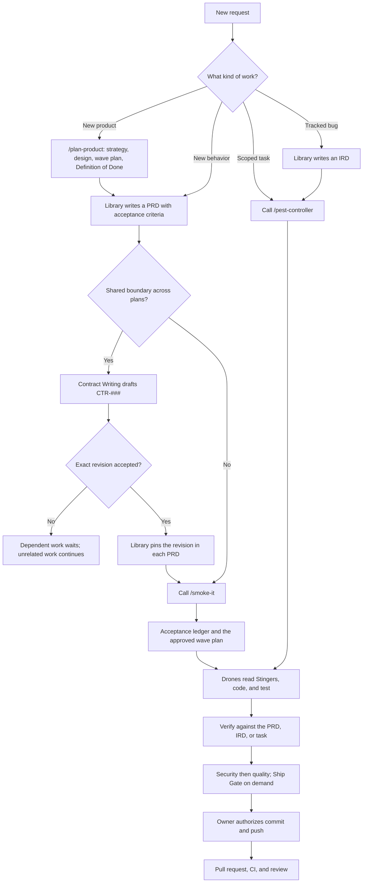
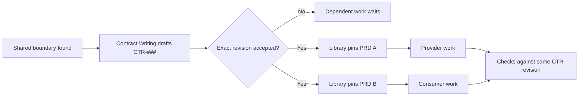

<!-- Generated from the source publication template. Edit the source template, not this public copy. -->
<div align="center">

<a href="assets/the-wasp-nest.png"></a>

# The Wasp Nest

### Get the Git life.

**184 specialist Drones, 223 Stingers, commands, hooks, and rules across 21 installable plugins.**

Give your coding assistant the people, playbooks, and project memory it needs to build.

[](https://github.com/legioncodeinc/vibe-coding-tools/releases)
[](https://github.com/legioncodeinc/vibe-coding-tools/actions/workflows/release.yml)
[](LICENSE.md)

</div>

<div align="center">

<a href="https://www.ospry.ai">
  <picture>
    <source media="(prefers-color-scheme: dark)" srcset="https://raw.githubusercontent.com/legioncodeinc/brands/main/ospry/logos/png/core-assets/transparent/horizontal-white-1024.png">
    <source media="(prefers-color-scheme: light)" srcset="https://raw.githubusercontent.com/legioncodeinc/brands/main/ospry/logos/png/core-assets/transparent/horizontal-ink-1024.png">
    
  </picture>
</a>

<sub>Want to know what will actually drive more revenue? <strong><a href="https://www.ospry.ai">OSPRY</a></strong> is the insight engine built for exactly that.</sub>

</div>

## Start here

Install [Claude Code](https://code.claude.com/docs/en/overview) or [Codex](https://developers.openai.com/codex), then add the public marketplace. In Claude Code, enter these in the assistant's command prompt:

```text
/plugin marketplace add legioncodeinc/vibe-coding-tools
/plugin install wasp-nest-core@wasp-nest
```

In a terminal with Codex installed, add the same marketplace and select the core in the plugin browser:

```bash
codex plugin marketplace add legioncodeinc/vibe-coding-tools
codex plugin add wasp-nest-core@wasp-nest
```

The v3 layout has a required Core and the optional plugins declared in its current catalog. Purge the previous Wasp Nest installation before installing it. Keep Core enabled and select each workflow's prerequisites.

Choose the packs your work needs. Claude skills use their plugin namespace, such as `/wasp-nest-core:get-started-stinger`; Codex shows skills and command wrappers. Native Codex Drone roles require Core's trusted hook and an explicit registry of enabled package roots. The local installer writes that registry; a marketplace install alone is not proven to do so. Review the selection before trusting `/hooks` and starting a new session. See [harness capabilities](learn/reference/HARNESS-CAPABILITIES.md).

Open the repository you want to work on and ask:

```text
Use the Get Started Stinger to inspect this repository. Explain the home instruction setup and the project Library setup, ask before changing either, and show me the resulting diff and setup report.
```

The first-session hook checks home and project setup locks on supported local hosts. Missing setup prompts an offer. Existing code gets a Knowledge pass before Library setup completes. [Read Getting Started](learn/guides/GETTING-STARTED.md) before accepting either offer.

## The problem this fixes

Your assistant can write code. It still needs your product facts, past decisions and definition of done.

Drones own bounded specialties. Stingers carry methods, examples and cited research. The Library keeps knowledge, plans, issue fixes and shared contracts for the next agent. You can check the work against written decisions.

## The Library is the workbench

The Library holds current facts and future plans in your project. Get Started offers setup after consent; Knowledge documents existing code first. Human-only `library/notes/` is not agent input.

| Record | Write it when | Who helps |
| --- | --- | --- |
| Knowledge and ADR | You need current system truth or the reason for an architecture choice. | Knowledge or ADR Writing Stinger. |
| PRD | You plan new behavior and need observable acceptance criteria. | Library Stinger. |
| IRD | A tracked bug needs a bounded fix and proof, using its issue number. | Library Stinger. |
| `CTR-###` | Two or more plans depend on the same API, event, data shape, permission, or state transition. | Contract Writing drafts; you accept the exact revision; Library pins it in each affected PRD. |

Learn [why the Library exists](learn/concepts/WHY-THE-LIBRARY.md), [write a PRD](learn/guides/WRITE-A-PRD.md) or [IRD](learn/guides/WRITE-AN-IRD.md), and [agree on a CTR](learn/guides/WRITE-A-CTR.md). Draft contracts block dependent work.

## From request to reviewed code



`/smoke-it` is the full PRD execution path. It selects Drones from the roster itself, so you do not need to call `/pest-controller` first. Use `/pest-controller` to route a bounded task or IRD fix. Smoke It includes security and quality close-out; `/ship-gate` is the on-demand gate for a scoped diff. Neither command grants permission to commit, push, or deploy.

For parallel PRDs, one accepted contract revision is the handoff:



A Draft or disputed contract blocks the dependent boundary. [The learning path](learn/README.md) has the document-authoring guides, worked example, and more diagrams.

## What to call

Short Core commands use `/wasp-nest-core:` in native Claude. Optional commands show their owning prefix below. Use your client's exact selector; local home installations also expose flat commands.


| Situation | Ask for | What happens |
| --- | --- | --- |
| New or existing repository has no Library | `get-started-stinger` | Offers home and project setup separately, preserves existing work, and reports its changes. |
| Plan a new product before building it | [`/product-studio:plan-product`](plugins/product-studio/commands/plan-product.md) | Interviews you for the strategy, designs the UX with prototypes and a Claude Design round trip, then writes the PRD map, wave plan and Definition of Done, with your approval at each stage. |
| Planned feature | `library-stinger`, then `/smoke-it` once the PRD is ready | Defines criteria before code, then tracks implementation and verification. |
| Shared provider and consumer behavior | `contract-writing-stinger` before dependent PRDs finish | Records a CTR, requests acceptance, and hands the revision to Library for PRD pins. |
| Tracked defect or bounded task | `library-stinger` for an IRD if tracked, then `/pest-controller` | Routes a scoped fix to an armed Drone. |
| Standalone pre-ship check | `/ship-gate` | Reviews the diff in order: security, quality, repository health, then your decision. |
| Founder, investor, sales, service or public documents | [`/documentation-tools:library-packets`](learn/guides/DOCUMENT-WORKFLOWS.md#library-packets-share-what-the-sources-support) | Reads a library and produces supported Markdown, Word, branded PDF and citations. |
| Prepare a new or partial app for a build | [`/app-primer-zero:app-primer-zero`](learn/guides/DOCUMENT-WORKFLOWS.md#app-primer-zero-prepare-the-build) | Establishes current state, drafts contracts and schema, then hands off a bounded build plan. |
| Refresh stale repository knowledge across many files | [`/documentation-tools:kb-refresh`](learn/guides/DOCUMENT-WORKFLOWS.md#kb-refresh-bring-repository-knowledge-current) | Rechecks code citations, updates owned docs, and reports drift and suspected code issues. Full discovery also needs Code Audit. |
| Assess a public website | [`/website-audit-tools:perform-website-audit`](plugins/website-audit-tools/commands/perform-website-audit.md) | Runs intake, site evidence, findings, scores and branded reports. |
| Assess a codebase | [`/code-audit-tools:audit-my-code`](plugins/code-audit-tools/commands/audit-my-code.md) | Selects an audit tier and produces evidence, a brief and any approved remediation plan. |
| Capture a running app | [`/browser-and-app-testing-tools:webapp-capture`](plugins/browser-and-app-testing-tools/commands/webapp-capture.md) | Creates scoped screenshots, demos or a visual inventory after intake and a dry run. |
| Manage several implementation sessions | [`/data-and-ai-tools:tars`](plugins/data-and-ai-tools/commands/tars.md) | TARS manages the work, CASE challenges and resolves scoped decisions, and KIPP runs the Feature Desk. All three require Claude Code Desktop. |

These are Claude entry points. Other clients use supported Stingers or command wrappers. TARS, CASE and KIPP have no Codex, Cursor or Cowork fallback; they require Claude Code Desktop. Invocation does not authorize external actions.

Keep Core installed alongside each owning plugin. [Choose a document workflow](learn/guides/DOCUMENT-WORKFLOWS.md) for prerequisites, sample requests and the difference between preparing an app, refreshing its knowledge and explaining it to readers. Use `/wasp-nest-core:forge` for a new reusable component; public correction requests belong in the issue tracker below.

## The parts, in plain English

| Piece | What it is |
| --- | --- |
| **Drone** | A specialist agent with a bounded responsibility. |
| **Stinger** | The procedure and reference material a Drone reads before working. Some Stingers are standalone orchestrators. |
| **Pest Controller** | The router that chooses and arms the right Drone. |
| **Product Studio** | The planning plugin: strategy, UX design, and the build plan (PRD map, wave plan, Definition of Done) before any PRD is written. |
| **Smoke It** | The execution workflow that drives PRD criteria to verified completion, in the approved wave order. |
| **Rule** | A persistent operating boundary for supported harnesses. |
| **Hook** | A lifecycle check, including the consent-based first-session setup offer. |

The Drone and Stinger pairing is enforced by the source validator. A missing pairing is not silently shipped.

## What ships

Marketplace release **v3.0.1**. The core and add-on packs have independent manifest versions; counts and descriptions below are read from the built plugins, not maintained by hand.

| Plugin | Version | Stingers | Drones | What it does |
| --- | --- | ---: | ---: | --- |
| [wasp-nest-core](plugins/wasp-nest-core/README.md) | 3.0.1 | 18 | 14 | The Wasp Nest core: shared Drones and Stingers, orchestration commands, rules, and hooks. |
| [app-primer-zero](plugins/app-primer-zero/README.md) | 3.0.1 | 1 | 0 | Prepare an app library, contracts, schema baseline and a wave handoff before building. |
| [backend-and-desktop-tools](plugins/backend-and-desktop-tools/README.md) | 3.0.1 | 10 | 10 | Implement TypeScript, Python, Go, Rust, native apps, APIs and terminal workflows. |
| [browser-and-app-testing-tools](plugins/browser-and-app-testing-tools/README.md) | 3.0.1 | 4 | 4 | Automate browsers, capture live apps and measure Lighthouse/PageSpeed behavior. |
| [business-and-product-tools](plugins/business-and-product-tools/README.md) | 3.0.1 | 15 | 15 | Form and run a company, discover product needs, hire teams and improve delivery. |
| [code-audit-tools](plugins/code-audit-tools/README.md) | 3.0.1 | 12 | 11 | Audit repositories and app security, measure bloat, inspect branches and plan remediation. |
| [content-intelligence](plugins/content-intelligence/README.md) | 3.0.1 | 2 | 0 | Find and verify current repository/news topics and prepare voice-matched drafts. |
| [data-and-ai-tools](plugins/data-and-ai-tools/README.md) | 3.0.1 | 12 | 12 | Design data, retrieval, AI runtime, model tooling and agent operations. |
| [developer-learning-tools](plugins/developer-learning-tools/README.md) | 3.0.1 | 4 | 4 | Explain technical sources with source-grounded analogies and learner checks. |
| [documentation-tools](plugins/documentation-tools/README.md) | 3.0.1 | 8 | 8 | Refresh, extract, publish and package documentation from real sources. |
| [growth-and-customer-tools](plugins/growth-and-customer-tools/README.md) | 3.0.1 | 15 | 15 | Research buyers, acquire leads, follow up, support customers and grow accounts. |
| [highlevel](plugins/highlevel/README.md) | 3.0.1 | 3 | 3 | Integrate HighLevel, build with AI Studio and map exported workflows. |
| [infrastructure-decision-tools](plugins/infrastructure-decision-tools/README.md) | 3.0.1 | 6 | 6 | Prepare platform assets and account dependencies without implicit setup actions. |
| [littlebird-toolkit](plugins/littlebird-toolkit/README.md) | 3.0.1 | 30 | 0 | Turn Littlebird memory into evidence-backed operating work. |
| [media-and-creative-tools](plugins/media-and-creative-tools/README.md) | 3.0.1 | 4 | 4 | Create consented photography and integrate voice and video production. |
| [platform-and-release-tools](plugins/platform-and-release-tools/README.md) | 3.0.1 | 20 | 20 | Integrate authentication, payments, analytics, messaging and production delivery. |
| [product-studio](plugins/product-studio/README.md) | 3.0.1 | 3 | 3 | Turn an idea into a buildable plan: product strategy, Claude-Design-grade UX, a PRD map, a wave plan and a Definition of Done. |
| [repository-modernization-tools](plugins/repository-modernization-tools/README.md) | 3.0.1 | 1 | 1 | Compose repository baseline, safe refactoring and contributor onboarding through selected specialist owners. |
| [software-economics-tools](plugins/software-economics-tools/README.md) | 3.0.1 | 4 | 4 | Model supplied software economics and costs with explicit scenarios and evidence. |
| [web-development-tools](plugins/web-development-tools/README.md) | 3.0.1 | 30 | 30 | Build web interfaces and sites with React, Svelte, design systems and accessible components. |
| [website-audit-tools](plugins/website-audit-tools/README.md) | 3.0.1 | 21 | 20 | Audit a public website with crawl, SEO, accessibility, conversion and evidence-backed reports. |

The [Claude catalog](.claude-plugin/marketplace.json) and [Codex catalog](.agents/plugins/marketplace.json) expose these packs individually. Runtime guides and research distillations ship with them. Raw research archives, `node_modules/`, and ingested photography models do not. The photography pack retains only its blank model template.

The [complete plugin catalog](learn/reference/PLUGIN-CATALOG.md) lists every shipped Stinger, Drone and command by pack with purposes and direct instructions. The [hook catalog](learn/reference/HOOK-CATALOG.md) covers shared hooks and their host limits.

## Learn and build on it

- [How We Build](learn/guides/HOW-WE-BUILD.md) ([branded PDF](learn/pdf/How-We-Build-The-Wasp-Nest.pdf)): the whole workflow from idea to shipped, in plain language.
- [Getting Started](learn/guides/GETTING-STARTED.md): install, consent, and first project setup.
- [Components](learn/guides/COMPONENTS.md): Drones, Stingers, commands, rules, and hooks.
- [Write a PRD](learn/guides/WRITE-A-PRD.md), [IRD](learn/guides/WRITE-AN-IRD.md), or [CTR](learn/guides/WRITE-A-CTR.md), then [execute the plan](learn/guides/PRD-EXECUTION.md) with evidence.
- [Document workflows](learn/guides/DOCUMENT-WORKFLOWS.md): Library Packets, App Primer Zero and KB Refresh with example requests.
- [Model Selection](learn/guides/MODEL-SELECTION.md), [Security and Secrets](learn/guides/SECURITY-AND-SECRETS.md), and [Troubleshooting](learn/guides/TROUBLESHOOTING.md).

This repository is generated from canonical source. [Open an issue](https://github.com/legioncodeinc/vibe-coding-tools/issues) for corrections or component requests. Maintainers change the source with Queen Wasp and validate it before release.

## License and attribution

The Wasp Nest is created by **Mario Aldayuz and [Legion Code Inc.](https://www.legioncodeinc.com)**. First-party material is licensed under [AGPL-3.0-or-later](LICENSE.md). Embedded third-party material retains its own rights; see [third-party notices](THIRD-PARTY-NOTICES.md) and each pack's notices. This license replaces prior repository-specific usage terms.

Built for vibe coders. Go ship something you can prove works.

---

<div align="center">

<picture>
  <source media="(prefers-color-scheme: dark)" srcset="https://raw.githubusercontent.com/legioncodeinc/brands/main/legion-code-inc/logos/legion-symbol-dark.svg">
  <source media="(prefers-color-scheme: light)" srcset="https://raw.githubusercontent.com/legioncodeinc/brands/main/legion-code-inc/logos/legion-symbol-light.svg">
  
</picture>

<sub><strong>We are Legion. Vibe with Legion.</strong></sub>

</div>
