# How We Build: From Idea to Shipped

> Guide | Version 1.0 | 2026-10-12 | Current | Written for an 8th-grade reading level

This guide explains, step by step, how a project goes from "I have an idea" to "it is live and it works." It follows the way Legion Code Inc. actually builds software with AI helpers and The Wasp Nest. You do not need to be an expert to follow it. Every step says what you do, what the AI does, what you get, and how you know the step is finished.

A printable, branded copy of this guide lives next to it: [How We Build (PDF)](../pdf/How-We-Build-The-Wasp-Nest.pdf).

## Contents

- [The short version](#the-short-version)
- [How it all fits together](#how-it-all-fits-together)
- [Meet the team](#meet-the-team)
- [Before you start: the rules of the road](#before-you-start-the-rules-of-the-road)
- [Step 0: Set up your computer (once)](#step-0-set-up-your-computer-once)
- [Step 1: Make or open the repo](#step-1-make-or-open-the-repo)
- [Step 2: Get Started (and Knowledge)](#step-2-get-started-and-knowledge)
- [Step 3: Plan the product with Product Studio](#step-3-plan-the-product-with-product-studio)
- [Step 4: Turn on TARS, then meet CASE and KIPP](#step-4-turn-on-tars-then-meet-case-and-kipp)
- [Step 5: Write the PRDs with the Library](#step-5-write-the-prds-with-the-library)
- [Step 6: Lock the wave plan and the Definition of Done](#step-6-lock-the-wave-plan-and-the-definition-of-done)
- [Step 7: Write contracts for shared parts](#step-7-write-contracts-for-shared-parts)
- [Step 8: Build in waves with Smoke It and the Pest Controller](#step-8-build-in-waves-with-smoke-it-and-the-pest-controller)
- [Step 9: Pass the Ship Gate](#step-9-pass-the-ship-gate)
- [Good habits that save time](#good-habits-that-save-time)
- [Checklists you can copy](#checklists-you-can-copy)
- [When something goes wrong](#when-something-goes-wrong)
- [Words to know](#words-to-know)
- [Honest notes: rough edges we know about](#honest-notes-rough-edges-we-know-about)
- [Where to learn more](#where-to-learn-more)

## The short version

Step 0 happens once on each computer. Steps 1 to 9 happen for every project. Click a step's title to jump to the full page.

0. **[Set up your computer](#step-0-set-up-your-computer-once):** Install the basic tools and make one central `github` folder in your home folder.
1. **[Make or open the repo](#step-1-make-or-open-the-repo):** Create or open the project in GitKraken, inside your `github` folder, on a new branch.
2. **[Get Started](#step-2-get-started-and-knowledge):** Set up the project's Library and checks. On a project that already has code, **Knowledge** also explains the code.
3. **[Plan with Product Studio](#step-3-plan-the-product-with-product-studio):** Strategy first, then design, then the build plan.
4. **[Turn on TARS](#step-4-turn-on-tars-then-meet-case-and-kipp):** TARS manages the work. **CASE** checks big decisions. **KIPP** catches new ideas that show up mid-build.
5. **[Write the PRDs](#step-5-write-the-prds-with-the-library):** The Library writes the build agreements, each with testable acceptance criteria.
6. **[Lock the wave plan and Definition of Done](#step-6-lock-the-wave-plan-and-the-definition-of-done):** Approve the build order and the finish line.
7. **[Write contracts](#step-7-write-contracts-for-shared-parts):** Agree on anything two pieces of work share before either side builds it.
8. **[Build in waves](#step-8-build-in-waves-with-smoke-it-and-the-pest-controller):** Smoke It and the Pest Controller build and verify every acceptance criterion.
9. **[Pass the Ship Gate](#step-9-pass-the-ship-gate):** Security, then quality, then repository health, then your OK.

<!-- pdf:flow-cards -->

## How it all fits together

This map shows the whole trip. The solid arrows are the normal path. The dotted arrows show what happens when a new idea shows up in the middle of a build.

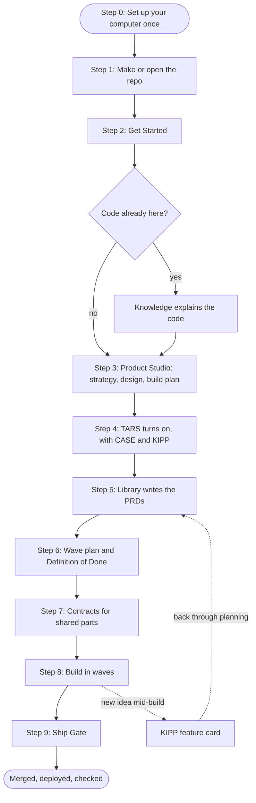

Here is who talks to whom while the work runs:

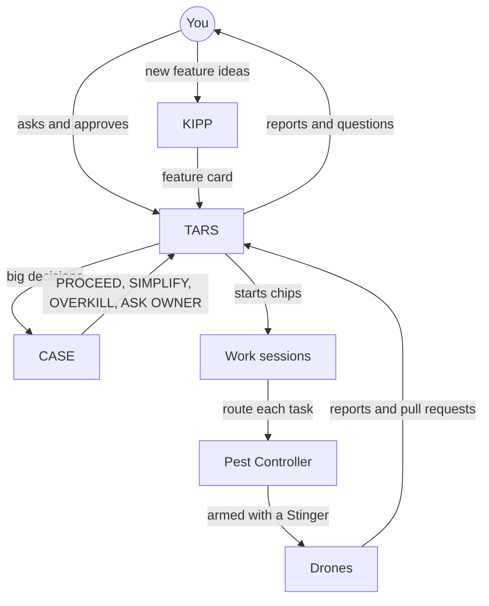

## Meet the team

Building with The Wasp Nest is like running a small company where most of the workers are AI helpers. Each one has one job. Here is who is who.

| Name | What it is | Think of it as |
| --- | --- | --- |
| **You (the owner)** | The person in charge. Only you approve money, secrets, merges to `main`, and anything that leaves your computer. | The boss |
| **Drone** | An AI helper with one job, like security or databases. Its file name ends in `-wasp-drone`. | A specialist on the team |
| **Stinger** | The skill a Drone must read before it starts. It holds the steps, rules, and research for that job. Its name ends in `-stinger`. | The specialist's training manual |
| **Pest Controller** | The router. It looks at a task, picks the right Drone, and hands it its Stinger. | The dispatcher |
| **Queen Wasp** | The skill that creates new Drones and Stingers (the `/forge` command). | The trainer who hires new specialists |
| **TARS** | The manager. It starts work sessions, watches them, and makes sure each one finishes. It writes no code. | The project manager |
| **CASE** | The adviser TARS checks with before big moves. It answers PROCEED, SIMPLIFY, OVERKILL, or ASK OWNER. | A wise second opinion |
| **KIPP** | The feature desk. You talk to KIPP about new feature ideas that come up while building. | The front desk for new requests |
| **The Library** | The `library/` folder in every project. It holds what was agreed, why, and the proof that it got done. | The project's memory |
| **Plugin (pack)** | A bundle of Drones and Stingers you can install. Wasp Nest Core is required. The other packs are optional. | A toolbox |

The rule that ties it together: **a Drone never works without first reading its Stinger.** That is called being "armed." A Drone sent out without its Stinger is treated as a mistake and is sent again.

## Before you start: the rules of the road

These rules apply in every step. They keep the work safe and keep you in control.

### Things that always need your "yes"

The AI must stop and ask you before it:

- deletes, moves, or renames something it did not create,
- touches another session's files,
- commits, pushes, opens a pull request (PR), merges, or deploys,
- spends money, enters a password or key, or installs a tool,
- changes settings, permissions, or configuration.

Saying "yes" once only counts for that one thing. A later step needs its own "yes."

### Work in time blocks

The AI works in blocks of time, usually 60 minutes. At the start it writes three lines: the **task**, the **start time**, and any **questions**. While it works:

- every 5 minutes there should be real progress (a file changed, a check ran, a question was asked),
- after 10 minutes stuck on one problem, it tells you,
- after 20 minutes with no progress, it stops, saves its work, and reports,
- at 45 minutes it sends a one-line status,
- at the deadline it checks in and stops unless you say to keep going.

It may try the same thing at most 2 times, and at most 3 different ways, before it stops and asks you.

### Every block ends with a report

The report always has the same six parts, so you can read it fast:

| Part | What it says |
| --- | --- |
| **Status** | DONE, PARTIAL, BLOCKED, or STOPPED, and how long it took |
| **Delivered** | What exists now, with file paths |
| **Verified** | Which checks actually ran, with real error text if something failed |
| **Not done** | What is left and why |
| **Questions** | Numbered questions, each with a recommended answer |
| **Out of scope** | Things it noticed but did not touch |

Before it stops, the AI saves its work and writes down where things stand: what is finished, what failed, and what questions are open. Longer efforts keep this in a handoff note (TARS, for example, saves a `manager-handoff.md`), so the next session (or the next person) can pick up exactly where the last one stopped.

### The beacon

A small background helper called the **beacon** writes a "heartbeat" file every time something happens in a session. It lives in `~/.wasp-nest/beacon/`. TARS reads these heartbeats to tell whether a session is still making progress. The beacon only watches. It never blocks anything.

### Writing style

Plain words. Short sentences. No em dashes or en dashes (a hook checks for them). Each document says whether it is current or historical, with a date.

## Step 0: Set up your computer (once)

Do this one time on each computer you build on. It takes about 30 minutes and saves hours of confusion later.

### Make one central `github` folder

Every project you work on should live in **one folder in your user (home) directory** called `github`. Each project (repo) gets its own folder directly inside it.

```text
~/github/                    your one home for all code
  my-first-app/              one folder per project (repo)
  company-website/
  mobile-app/
```

`~` means your home folder. On a Mac that is `/Users/<your-name>`. On Windows it is `C:\Users\<your-name>`.

**Why this matters:**

- You always know where every project is. So do your AI helpers.
- The folder name matches the repo name on GitHub. `~/github/my-first-app` is `github.com/<you>/my-first-app`.
- Tools that remember a project's location (like worktrees, GitKraken, and the AI's memory) keep working because the path never changes.

**How to make it on a Mac:** open the Terminal app and type:

```bash
mkdir -p ~/github
open ~/github
```

**How to make it on Windows:** open PowerShell and type:

```powershell
New-Item -ItemType Directory -Force "$HOME\github"
explorer "$HOME\github"
```

**Tell GitKraken to use it.** In GitKraken, open **Preferences**, find the default folder setting for cloning and new repositories, and point it at `~/github`. Then every repo you clone or create lands in its own folder inside it.

### Rules for the `github` folder

- **Not in a synced folder.** Do not put it inside iCloud Drive, Dropbox, OneDrive, Google Drive, or your Desktop or Documents folder if those sync to the cloud. Syncing can break the hidden `.git` folder that tracks your history. GitHub is your backup.
- **Pick the spot once and do not move it.** Moving a project breaks the links to its worktrees. (This really happened: old worktrees stopped working after a project folder was moved.) If you ever must move one, ask the AI to run `git worktree repair` and `git worktree prune` afterward.
- **No project inside another project.** Each repo gets its own folder, side by side.
- **Simple names.** Use lowercase letters and dashes, like `my-first-app`. No spaces.
- **Show hidden files.** Important folders start with a dot, like `.git`, `.github`, and `.claude`. On a Mac, press **Command + Shift + .** in Finder to show them.

### Install the basic tools

| Tool | What it is for |
| --- | --- |
| **Git** | Tracks every change to your code |
| **GitHub account** | Stores your code online and runs CI |
| **GitHub CLI (`gh`)** | Lets the AI open pull requests and check CI. Run `gh auth login` once to sign in yourself. |
| **GitKraken** | A visual way to see branches, worktrees, and history |
| **Claude Code desktop app** | Where TARS, CASE, and KIPP run |
| **The Wasp Nest** | The Drones, Stingers, and commands in this guide. See [Getting Started](GETTING-STARTED.md). |
| **Your project's language tools** | For example Node.js or Python, depending on the project |

Sign in to accounts yourself. Never paste a password or secret key into a chat with the AI. Keep secrets in a secrets manager (like Doppler) or in a local `.env` file that is never committed.

**Done when:** `~/github` exists, GitKraken points at it, and the tools above are installed and signed in.

## Step 1: Make or open the repo

**What you do:** Open GitKraken. Either create a new repository (repo) on GitHub or open one you already have. Clone or create it inside `~/github/`.

**How branches work here:**

- `main` is the finished, working version. Nobody works on `main` directly.
- Every new piece of work gets its own **branch** with a clear name, like `feature/<topic>` for big work or `legion/<topic>` for work done in an AI session.
- Each branch gets its own **worktree**. A worktree is a second copy of the project folder, tied to one branch. This lets several AI sessions work at the same time without stepping on each other.
- When work is ready, it goes into `main` through a **pull request (PR)**.

Here is what that looks like over time. Each piece of work branches off `main`, gets built, and merges back through a pull request:

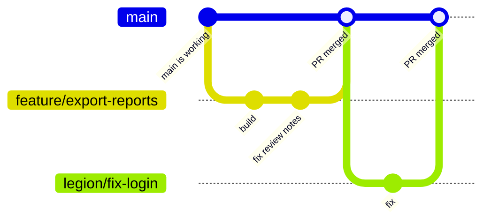


**Start every work session the same way:**

1. Get the latest `main` from GitHub (in GitKraken, click **Pull** while on `main`).
2. Make a new branch from that fresh `main`.
3. Do the work on the branch, never on `main`.

**Where worktrees go:** the Claude Code desktop app keeps its worktrees inside the project, in `.claude/worktrees/`. You do not need to make them by hand. Just do not move or rename them.

**Done when:** the repo exists inside `~/github/`, you can see it in GitKraken, and you are on a new branch, not on `main`.

## Step 2: Get Started (and Knowledge)

**What you do:** Run `/get-started-stinger`, or say "run Get Started in this repo."

**What the AI does:**

1. **Home setup (only the first time on a computer).** It offers to add your personal working rules to your AI tools. It asks first and makes a backup.
2. **Repo setup.** It checks for a file called `wasp-nest.lock`. If the file is there, setup already happened and it skips ahead. If not, it explains the Library and asks if you want to set up.
3. If you say yes, it adds these, in this order:
   - basic files like `.gitignore` and `.env.example`,
   - GitHub files: automatic checks (CI) for lint, type checks, and tests, plus security scanning and issue templates,
   - a `README.md`, plus `CONTRIBUTING.md`, `SECURITY.md`, and `CHANGELOG.md`,
   - the `library/` folder, last.

**The big safety rule:** Get Started **never overwrites** a file. For each file it reports "created," "already there, unchanged," or "different, not touched."

**If the project already has code,** Get Started must also run **Knowledge** (`/knowledge-stinger`) before it can finish. Knowledge reads the code and writes plain explanations of how it works. It starts with an overview and a system diagram, then covers areas like data, security, and how a request moves through the app. These go in `library/knowledge/private/<area>/`.

**What you get:** a project that has the same safe starting point as every other project, plus a Library ready to hold your plans.

How Get Started decides what to do:

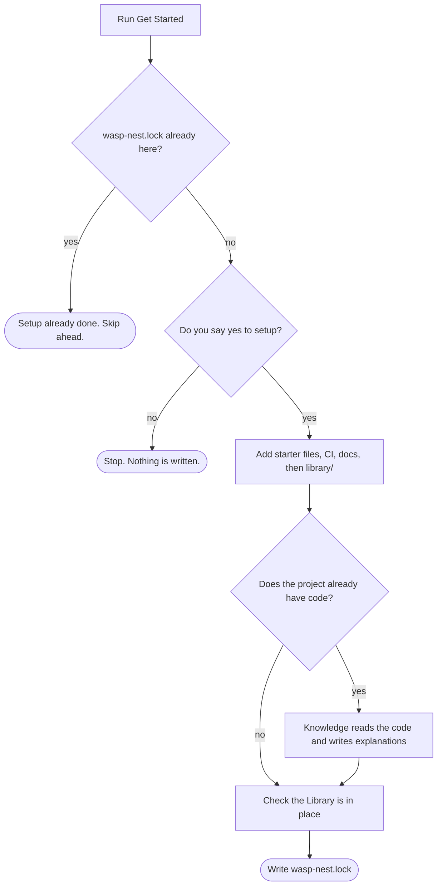


**Done when:** `wasp-nest.lock` exists. Get Started only writes it after the Library is in place and, for existing code, after Knowledge has finished.

### What is inside the Library

```text
library/
  knowledge/
    public/                 things safe to share
    private/                how the system works, decisions, contracts
      contracts/            CTR contracts live here
      standards/            rules like the Definition of Done
      product/              strategy and design from Product Studio
  requirements/
    backlog/                PRDs not started yet
    in-work/                PRDs being built
    completed/              PRDs that are done and proven
    plans/                  PRD map, wave plan, handoff packet
    reports/                security and quality reports
  issues/
    backlog/  in-work/  completed/    IRDs (bug and issue write-ups)
  notes/                    human-only notes; AI does not write here
```

A document's **folder is its status.** When a PRD moves from `backlog/` to `in-work/` to `completed/`, the whole folder moves. Changing a word in the file does not count.

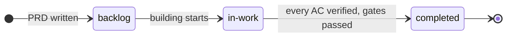


## Step 3: Plan the product with Product Studio

This is where an idea becomes a plan you can build. Product Studio is a plugin made for this step. Run `/product-studio:plan-product`. It works in three parts, and **you approve each part before the next one starts.**

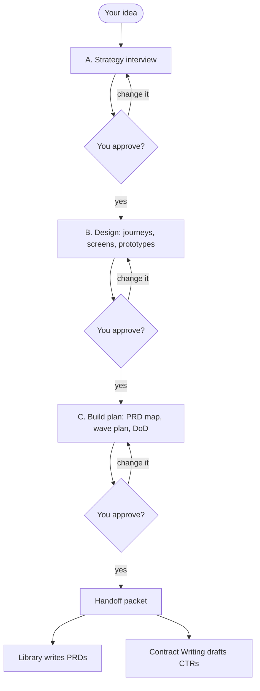


### Part A: Strategy (`product-strategy-stinger`)

**What it does:** It interviews you with short questions. Each question comes with a recommended answer, so you can just say "yes" or change it. It never makes up your strategy.

**What you get:** `library/knowledge/private/product/product-strategy.md`, which answers:

- What problem are we solving, and for whom?
- What job does the customer "hire" this product to do?
- Why would they pick us instead of something else?
- What are our 2 to 4 big bets?
- What one number shows we are winning (the north-star metric), and what 3 smaller numbers push it?
- What is in version 1, and just as important, what is **not**?
- What is our riskiest guess, and how do we test it cheaply?

When it needs deeper research, it calls in the specialists that already exist: ideal customer research, competitor research, and product discovery.

### Part B: Design (`product-design-stinger`)

The goal is user experience (UX) and user interface (UI) as good as Claude Design. It works from the strategy. First it shows you 2 or 3 possible design directions, and you pick one. It builds no prototypes until you have picked.

**What you get, in `library/knowledge/private/product/design/`:**

- **User journeys:** the path a real person takes, from first visit to getting value.
- **Screen map:** every screen and how they connect.
- **Task flows:** diagrams of the key things people do.
- **Screen specs:** for each screen, what it shows when it is empty, loading, has an error, and works.
- **Accessibility baseline:** so people using keyboards or screen readers can use it.
- **Clickable prototypes:** real HTML pages you can open and click, with light and dark modes.

Before you see anything, the AI grades its own work with a design checklist (clear layout, spacing, type, color contrast, calm motion, every state covered, nothing that looks generic or "AI-made").

**Claude Design, both directions:**

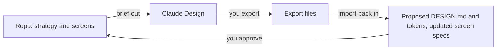


- **Out:** it builds a brief you can take into Claude Design. You upload it yourself. The AI never uses your account.
- **Back in:** when you export your work from Claude Design, it first checks the export for anything unsafe. Then it writes a **proposed** `DESIGN.md` and proposed design tokens (named colors, sizes, and spacing), and updates the screen specs. It records where each piece came from. It never overwrites the project's real `DESIGN.md`. You decide whether the proposal becomes the real one.

Other design helpers it can call: **Design System** (to build a full design system from scratch), **Impeccable** (to polish and run the anti-slop check), and **UX-UI** (to make sure the code follows the design later).

### Part C: The build plan (`product-planning-stinger`)

**What you get:**

- **PRD map:** the list of PRDs to write, with one line on each, what each depends on, and which shared parts need contracts.
- **Wave plan:** the build order, saved at `library/requirements/plans/wave-plan.md`. (Part of Step 6.)
- **Definition of Done:** saved at `library/knowledge/private/standards/definition-of-done.md`. (Part of Step 6.)
- **Handoff packet:** exact instructions for the Library (which PRDs to write) and for Contract Writing (which contracts to draft).

Product Studio plans. It does not write PRDs, contracts, or code. It hands those jobs to the right helpers.

**Done when:** you have approved the strategy, the design package, and the build plan.

## Step 4: Turn on TARS, then meet CASE and KIPP

**What you do:** In the Claude Code desktop app, run `/tars` (in plugin mode, `/data-and-ai-tools:tars`) or say "be TARS." TARS only works in the desktop app. If it cannot find the tools it needs, it says so and stops.

### TARS, the manager

TARS turns each thing you ask for into a **chip**. A chip is an offer to start a new work session. You click a chip to start it. Each chip has:

- one goal and one pull request,
- a brief that says which Drone does the work,
- what is already approved and what is not,
- what "done" means,
- the Ship Gate it must pass.

**How TARS starts up, in order:**

1. Loads its tools and your preferences.
2. Makes a folder for its notes: `.tars/<effort-name>/` with a `ledger.md` (the log), `watch.txt` (what CI to watch), and a `heartbeat` file.
3. Looks at what sessions are already running.
4. Offers to start **CASE**, then **KIPP**.
5. Starts its two timers: a check every 10 minutes and a CI check every 1 minute.
6. Only then starts work chips.

**The 10-minute check:** TARS reads what each session actually did. No progress for one check: it sends a nudge. No progress for two checks: it stops that session and gives the work a fresh brief.

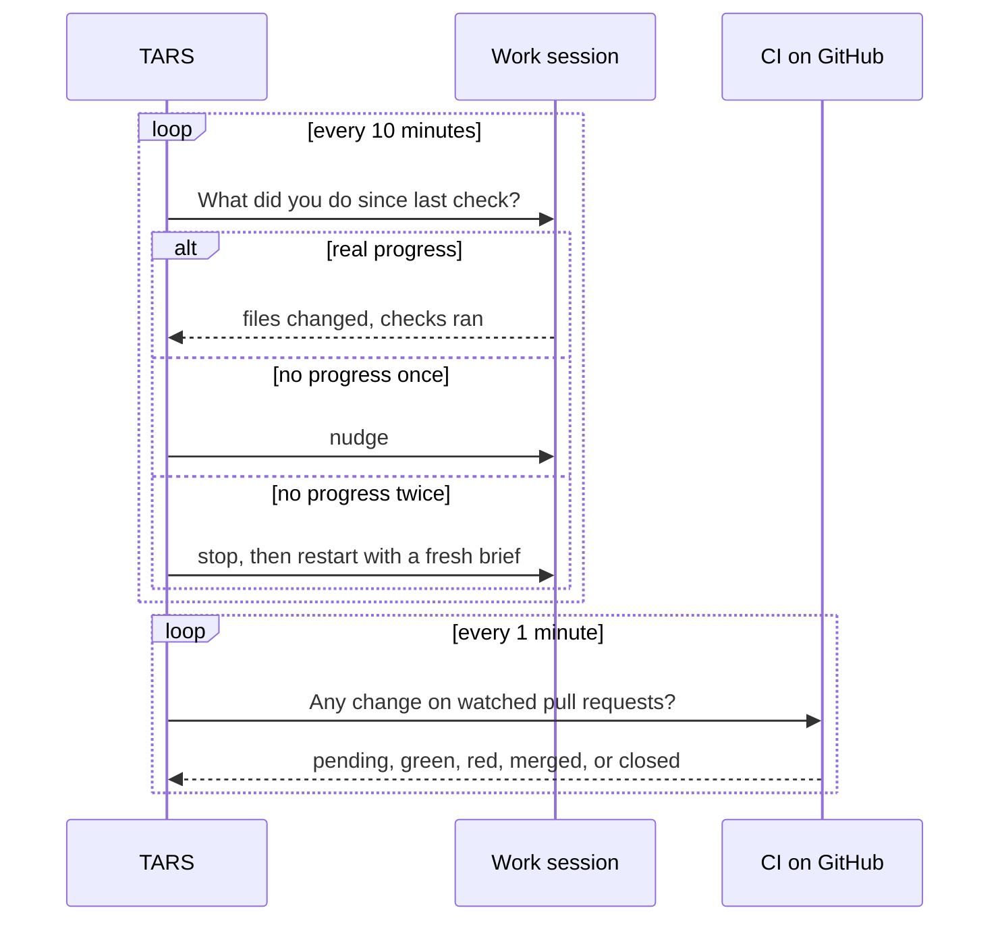


**The 1-minute CI check:** it watches each pull request and reports only when something changes: not started, pending, green, red, merged, or closed. "Not started" never counts as green. When a check turns green, TARS may merge into the shared work branch, but only into that branch. Production deploys stay yours.

### CASE, the adviser

CASE is a separate, read-only session. It only talks to TARS. It never edits files or talks to you directly.

A **CASE review** works like this: TARS sends one batch with your request, numbered questions, what TARS is leaning toward, and the exact version of the code. CASE answers one line per question:

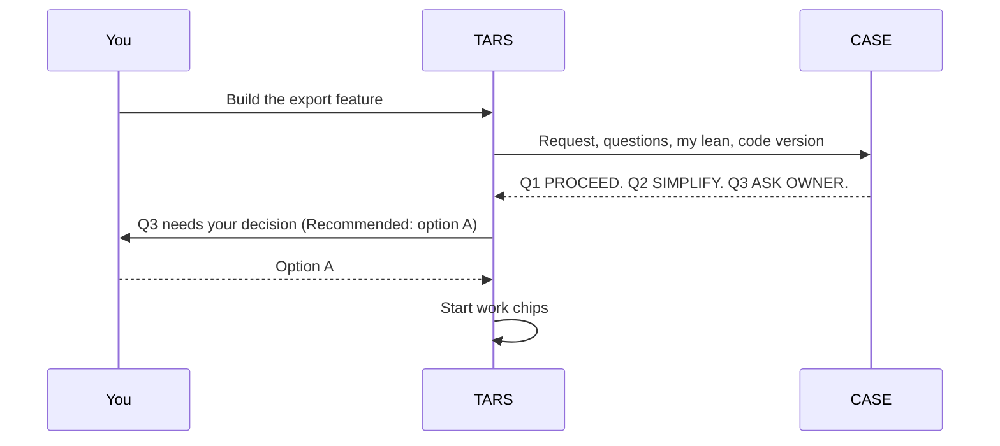


| Answer | Meaning |
| --- | --- |
| **PROCEED** | Go ahead as planned |
| **SIMPLIFY** | Good idea, but do less |
| **OVERKILL** | Too much for what you asked |
| **ASK OWNER** | Only you can decide this |

Anything bigger than one small pull request goes through CASE before work starts. A PROCEED from CASE is advice. It never replaces your approval for the things only you can approve.

### KIPP, the feature desk

**KIPP is for new feature ideas that come up in the middle of a build.** You talk to KIPP directly. It asks short questions, each with a recommended answer. It turns your idea into a **feature card**. It does not write code, PRDs, or contracts.

When a card is finished, KIPP hands it to TARS. TARS assigns the PRD and contract numbers, runs the plan past CASE, and starts a Library chip to write the PRD. The new idea then follows Steps 5 through 9 like everything else.

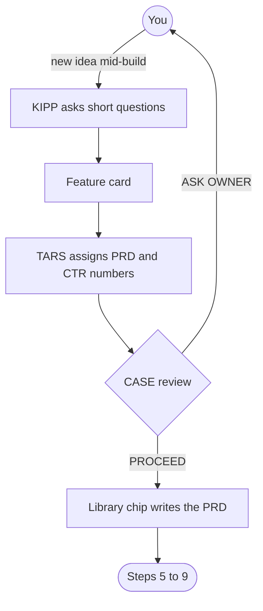


**Why the split matters:** Product Studio is for planning the whole product at the start. KIPP is for one new idea at a time, after building has begun. That keeps surprise ideas from quietly growing the project.

**Done when:** TARS is running, CASE and KIPP are offered, and the timers are on.

## Step 5: Write the PRDs with the Library

**What you do:** Run `/library-stinger` with the PRD list from the Product Studio handoff packet, or let TARS start a Library chip for it.

**What a PRD is:** a Product Requirements Document is a **build agreement**. It is not a to-do list. It says what the feature must do and how we will prove it works.

**Where it goes:**

```text
library/requirements/backlog/prd-007-export-reports/
  prd-007-export-reports-index.md          the main PRD
  prd-007a-export-reports-backend.md       a sub-PRD, if the work splits
  qa/prd-007-export-reports-qa.md          proof and test notes
```

PRD numbers count up inside each project. Bug and issue write-ups are called **IRDs**, and an IRD's number always matches its GitHub issue number.

**What is inside a PRD:** overview, goals, non-goals, sub-features, **acceptance criteria**, data and API changes, contract dependencies, open questions, and related documents.

**Acceptance criteria** are the most important part. Each one gets an ID and is written as **Given / When / Then**:

| ID | Given | When | Then |
| --- | --- | --- | --- |
| AC-1 | a signed-in user with saved reports | they click Export | a CSV file downloads within 5 seconds |

If you cannot test it, it is not a good acceptance criterion.

**Done when:** every PRD on the map exists in `backlog/`, each with testable acceptance criteria.

## Step 6: Lock the wave plan and the Definition of Done

Product Studio drafted both in Step 3. Now that the PRDs exist, check them again and approve them.

### The wave plan

A **wave** is a group of work that can happen at the same time because none of it depends on anything else in that group. Wave 2 waits for wave 1 to be **verified**, not just "done."

Here is an example with five PRDs. Login and the data model do not depend on each other, so they build at the same time in wave 1:

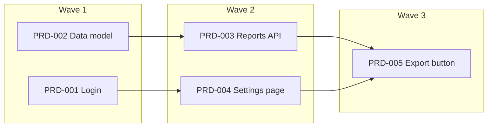


The wave plan in `library/requirements/plans/wave-plan.md` lists each wave, which PRDs and Drones are in it, what must be true before it starts, and what must be true before it ends. It includes a diagram of what depends on what. Smoke It and TARS read this file instead of inventing their own order.

### The Definition of Done

The **Definition of Done (DoD)** is one checklist that every PRD must pass before it counts as finished. It lives in `library/knowledge/private/standards/definition-of-done.md`. A typical project DoD says:

- every acceptance criterion is **VERIFIED** by a separate check, not just marked done by the one who built it,
- tests are written and passing,
- nothing that used to work is broken,
- the security review passed, then the quality review passed,
- the Knowledge docs are updated,
- the owner approved it.

**Done when:** you have approved both files.

## Step 7: Write contracts for shared parts

**What you do:** Run `/wasp-nest-core:contract-writing-stinger` (or `/contract-writing-stinger`).

**Why:** Sometimes two pieces of work depend on the same thing. For example, the backend team builds a web address that returns data, and the screen team builds the page that reads it. If they guess differently about what that data looks like, nothing fits together. A **contract (CTR)** writes down the exact agreement first, so both sides can build at the same time.

A CTR covers one shared boundary: an API, an event, a data shape, a permission, or a state change. It names who provides it, who uses it, the exact terms, the errors, and the tests each side must run.

**A contract's life:**

| State | Meaning |
| --- | --- |
| **Draft** | Being written. It can still change. Starts at revision 1. |
| **Accepted** | You approved this exact revision. Now it is frozen. |
| **Superseded** | A change was needed, so a new CTR number replaced it. |

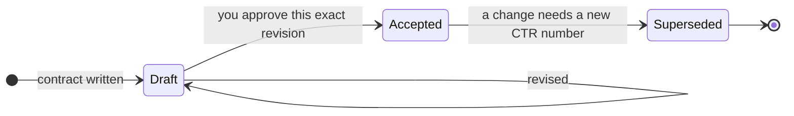


Only your direct approval makes a contract Accepted. After that, the Library adds a line like `CTR-004 revision 1` to every PRD that depends on it. Contracts live in `library/knowledge/private/contracts/`.

A Draft contract only blocks the work that depends on it. Everything else can keep moving.

**Done when:** every shared boundary on the PRD map has an Accepted contract.

## Step 8: Build in waves with Smoke It and the Pest Controller

**What you do:** Run `/wasp-nest-core:smoke-it` (or say "smoke it" or "run the PRDs"). For a single task outside a PRD, use `/wasp-nest-core:pest-controller`.

### What Smoke It does

1. **Makes a ledger.** It copies every acceptance criterion from every PRD into one list, the **AC ledger** (for example `EXECUTION_LEDGER.md`). Each line has an ID, the PRD it came from, the exact wording, an owner, and a status.
2. **Checks the contracts.** Any missing or Draft contract is flagged.
3. **Shows you the wave plan and waits.** Asking for a plan is not the same as saying "go."
4. **Runs the waves.** In each wave, the Pest Controller picks the right Drone for each piece and arms it with its Stinger. Independent pieces run side by side.
5. **Verifies.** A separate check, not the builder, moves each item from DONE to VERIFIED.

### The status of each acceptance criterion

| Status | Meaning |
| --- | --- |
| **OPEN** | Ready to start |
| **BLOCKED** | Waiting on a specific decision or missing piece |
| **IN PROGRESS** | Someone is working on it |
| **DONE** | Built and its own tests pass |
| **VERIFIED** | A separate check proved it matches the PRD |

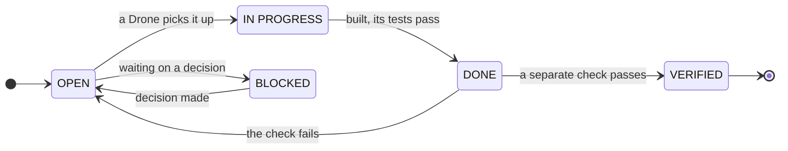


**No partial credit.** "Works except for one thing" is still OPEN. A fake or placeholder in real code is still OPEN.

### What the Pest Controller does

The Pest Controller holds the **roster**: the list of every Drone, what it is for, and when not to use it. It:

1. matches each task to the right Drone (it never makes up a Drone that is not on the roster),
2. plans the waves,
3. sends each Drone out armed with its Stinger,
4. watches for stuck Drones and gives their work a fresh brief,
5. reports back.

**Done when:** every acceptance criterion in the ledger is VERIFIED.

## Step 9: Pass the Ship Gate

Nothing gets committed or pushed until it passes the **Ship Gate**. You can run it any time with `/wasp-nest-core:ship-gate`. The order never changes:

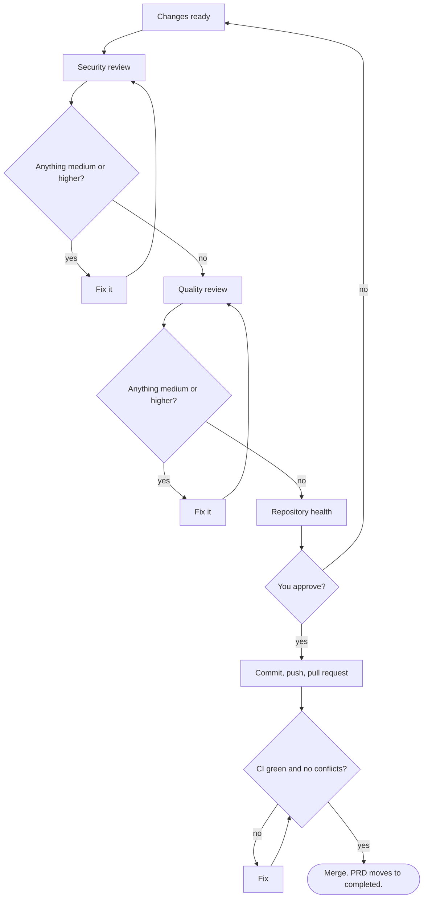


1. **Security first.** The security Drone checks the changes and writes a report in the PRD's `qa/` folder or in `library/requirements/reports/`. Everything rated medium or higher gets fixed, then security runs again.
2. **Quality second.** The quality Drone checks that what was built matches the PRD. It writes its report in the PRD's `qa/` folder or in `reports/`. Fixes, then a re-check.
3. **Repository health third.** The main session itself checks the repo's health (branch rules, CI, templates).
4. **Your review.** You read the reports and the summary, then say yes or no to committing and pushing.

**Why security goes first:** fixing a security problem changes the code. A quality check done before that fix would be checking old code.

After your yes:

5. The work is committed and pushed to its branch.
6. A pull request is opened.
7. Before calling it ready, the AI makes sure the branch has no conflicts with the latest `main`. If it does, it fixes them first.
8. CI runs. TARS watches it.
9. When CI is green and you approve, it merges. The PRD folder moves to `completed/`.

**Done when:** the PR is merged, CI is green, and the PRD is in `completed/` with its proof.

## Good habits that save time

These are lessons learned the hard way. None of them are required, but each one prevents a common mess.

### Working with the AI

- **One clear goal per session.** "Add the export button from PRD-007" works better than "improve the app." One chip, one goal, one pull request.
- **Answer with the recommended option when you agree.** The AI marks its suggestion "(Recommended)." Saying "yes" is fine. Changing it is also fine. Guessing what it meant is not.
- **Read the six-part report.** It is short on purpose. Look hardest at **Verified** and **Not done**. If Verified is empty, nothing was proven.
- **Do not approve what you have not read.** A "yes" to commit, push, or spend money is your signature.
- **Ask "how do you know?"** If the AI says something works, ask what check proved it. A good answer names a test, a file, or a report.
- **Stop early, not late.** If a session is going in circles, stop it and start fresh with a clearer brief. A fresh start is cheaper than a long, confused one.
- **Keep your own notes in `library/notes/`.** It is the one folder the AI does not write in.

### Working with Git and GitHub

- **Small pull requests.** Under about 400 changed lines is easy to review. Huge pull requests hide mistakes.
- **Commit and push often** (with your OK). Work that only lives on your computer is not backed up.
- **Delete branches after they merge.** Old branches pile up and confuse everyone, including the AI.
- **Do not let work sit uncommitted for days.** Big piles of uncommitted changes are hard to review and easy to lose.
- **Fix conflicts before asking for review.** A pull request that cannot merge blocks everyone.

### Keeping the project healthy

- **Keep secrets out of Git.** No passwords, keys, or tokens in code or in chat. If one leaks, change it right away; deleting the file is not enough.
- **Write it down in the Library.** Decisions, contracts, and plans that live only in a chat are forgotten by the next session.
- **Watch the cost.** AI time, video, cloud hosting, and paid APIs cost money. Ask what something costs before you approve it.
- **Keep your tools updated.** If a command in this guide is missing, your installed copy is probably older than the source.

## Checklists you can copy

### Setting up a new computer (once)

- [ ] `~/github/` created
- [ ] `~/github` is not inside a cloud-synced folder
- [ ] GitKraken's default folder points at `~/github`
- [ ] Git, GitHub CLI, GitKraken, and Claude Code desktop installed
- [ ] Signed in to GitHub (`gh auth login`) yourself
- [ ] The Wasp Nest installed

### Starting a new project

- [ ] Repo created or opened in GitKraken, inside `~/github/`
- [ ] Working on a new branch in its own worktree, not `main`
- [ ] Get Started finished and `wasp-nest.lock` exists
- [ ] Knowledge docs written (if there was existing code)
- [ ] Product strategy approved
- [ ] Design package approved (journeys, screens, prototypes)
- [ ] Build plan approved (PRD map, wave plan, Definition of Done)
- [ ] TARS running with CASE and KIPP offered

### Before each wave starts

- [ ] Every PRD in this wave has testable acceptance criteria
- [ ] Every shared boundary has an Accepted contract
- [ ] The wave before it is fully VERIFIED
- [ ] Each Drone has its own files and does not touch another's

### Before merging

- [ ] Security report: no open issues rated medium or higher
- [ ] Quality report: no open issues rated medium or higher
- [ ] Repository health checked
- [ ] No conflicts with the latest `main`
- [ ] CI is green
- [ ] Every item in the Definition of Done is checked
- [ ] You approved it

## When something goes wrong

| Problem | What to try |
| --- | --- |
| A session seems stuck | Ask TARS for that session's status. TARS nudges after one quiet check and restarts it after two. |
| TARS says it needs the desktop app | TARS only runs in the Claude Code desktop app. Open the project there. |
| The AI keeps retrying the same fix | It should stop after 2 tries of the same thing. Ask for its six-part report and the exact error. |
| Two pieces of work do not fit together | Look for a missing or Draft contract. Write or accept the CTR before building more. |
| A new idea shows up mid-build | Tell KIPP. Do not add it to a PRD that is already being built. |
| The design looks generic | Ask Product Studio to score it with the design checklist and run the Impeccable check. |
| A skill or command is missing | Your installed copy may be older than the source. Reinstall from the latest release. |

## Words to know

| Word | Meaning |
| --- | --- |
| **AC (acceptance criterion)** | One testable thing a feature must do |
| **Branch** | A separate line of work in Git |
| **CI** | Automatic checks that run on every push or pull request |
| **Chip** | An offer from TARS to start a new work session |
| **CTR** | A contract for a shared boundary between two pieces of work |
| **DoD** | Definition of Done: the checklist every PRD must pass |
| **IRD** | Issue Requirements Document: the write-up for a bug or GitHub issue |
| **Ledger** | A running list that tracks status, like the AC ledger or TARS's ledger |
| **PR** | Pull request: how a branch asks to be merged into `main` |
| **PRD** | Product Requirements Document: the build agreement for a feature |
| **Wave** | A group of work that can run at the same time |
| **Worktree** | A separate copy of the project folder tied to one branch |

## Honest notes: rough edges we know about

This guide describes how the system is meant to work today. A few parts are still new:

- **CASE and KIPP** were added to TARS on October 7, 2026. They are new, so watch their first few runs closely and report anything that seems off.
- **Product Studio** is new. Its strategy, design, and planning skills fill gaps that the older tools left open: nothing used to own the wave plan or the Definition of Done.
- **Claude Design exports** can change. If an export does not import cleanly, Product Studio's import checklist says what to check.
- **Installed copies can lag behind.** If a command in this guide is missing, update your install.

## Where to learn more

- [Getting Started](GETTING-STARTED.md): installing The Wasp Nest
- [Components](COMPONENTS.md): Drones, Stingers, commands, rules, and hooks
- [Execute a PRD](PRD-EXECUTION.md): the ledger and waves in more detail
- [Why the Library exists](../concepts/WHY-THE-LIBRARY.md): PRDs, IRDs, and contracts
- [Glossary](GLOSSARY.md): more terms
