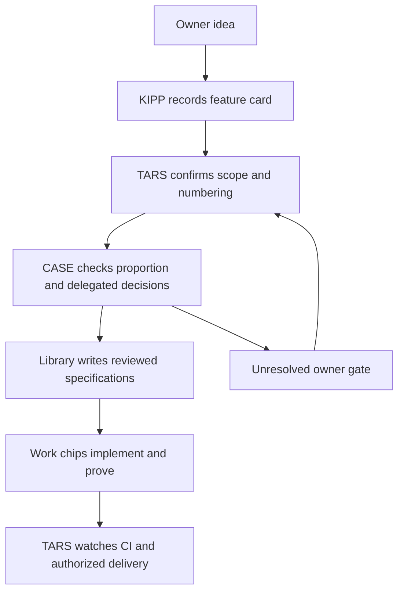

# TARS: manager, CASE and KIPP

Run `/tars <outcome>` in Claude Code Desktop's Code tab. TARS manages small work sessions, decisions, CI and handoffs. CASE is its advocate, twelfth man and scoped decision tie-breaker. KIPP is the owner's Feature Desk. None of the three implements product code.

## Start with the right team

Fill or restore the [owner profile](references/templates/owner-profile.md) from current instructions. Offer CASE first, KIPP next, then work chips. Confirm live tools and actual session state. This workflow is only compatible with Claude Code Desktop, not terminal Claude Code, Cowork, ChatGPT/Codex or Cursor. CASE/KIPP are helper-session briefs inside TARS, not separate marketplace agents.

## What each part does

| Part | What it does | How to use it |
|---|---|---|
| TARS | Owns ledger, routing, questions, authorized merges and handoffs | Enter `/tars`, load the skill and profile, follow the start guide |
| CASE | Challenges overkill; one verdict per question with inline conditions | Offer [case-brief.md](references/templates/case-brief.md), send the ask, evidence and TARS lean |
| KIPP | Captures ideas and owner answers; maintains cards and index | Offer [kipp-brief.md](references/templates/kipp-brief.md), use the card/index templates |
| Ten-minute tick | Reads actual work output and acts on stalls | Arm `CronCreate` only when the task authorizes recurring management; idle between events |
| One-minute CI watch | Emits PR/check state changes; tick cross-checks it | Run the existing poller under `Monitor` with approved repository/check settings |

TARS plus CASE agreement grants no default permission. Co-approval and tie-breaking require a recorded owner delegation for the named task. Verify owner decision relays against their original source. Money, credentials, production, new dependencies and other gates still need the owner's specific yes.

KIPP prepares local cards unless a docs PR is authorized. A no-CI docs lane needs the owner's policy and required path, contract and link proofs. Accepted contracts stay immutable by default. CASE and KIPP are never automatically archived.

## Reading order

1. [Operating model](guides/00-operating-model.md) and [CASE/KIPP roles](guides/07-case-and-kipp.md).
2. [Start and restore](guides/01-start.md), then [spawn and track](guides/02-spawn-and-track-chips.md).
3. [Tick](guides/03-ten-minute-tick.md), [CI watch](guides/04-ci-watch.md) and [decisions](guides/05-questions-and-decisions.md).
4. [Close-out](guides/06-close-out.md) and [manager handoff](references/templates/manager-handoff.md).

[REFERENCE.md](references/REFERENCE.md) maps the dated tool names, authority and state. [SKILL.md](SKILL.md) is the agent entry; [TOPIC.md](TOPIC.md) records scope. [Research](https://github.com/legioncodeinc/the-wasp-nest-source/blob/main/packs/data-and-ai-tools/skills/tars-stinger/references/research/README.md) preserves mechanism evidence. The [CI poller](scripts/ci-poll.sh) remains unchanged by the manager-role update.
