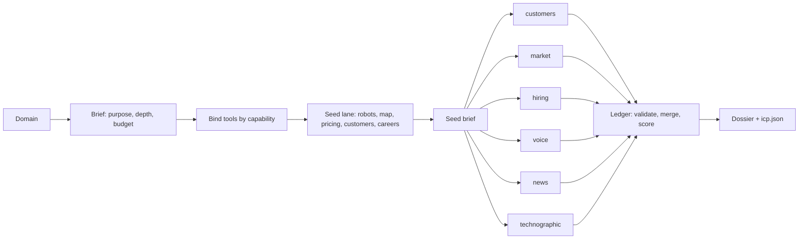

# ICP Research Stinger

`icp-research-stinger` turns a company domain into an evidence-backed Ideal Customer Profile for `icp-research-wasp-drone`. It is research-only: the outputs are a dossier, an evidence ledger, and a machine-readable profile.

## How a run flows



The six off-site lanes run in parallel: either one Drone per lane dispatched from the top level, or one agent batching parallel tool calls.

## What makes it different from "search and summarize"

- **Stated versus revealed.** Every signal is tagged: what the company says, or what its customers, reviewers, job postings, and pricing structure reveal. Revealed evidence decides the ICP; the gap between the two is reported as a finding.
- **Graded claims.** `scripts/icp_ledger.py` groups evidence by claim and grades it strong, moderate, weak, or contested by independent domains and source types. Only strong and moderate claims become findings.
- **Customers as the backbone.** Named customers from the company's own site are profiled on their own sites, so the ICP is built from real buyers rather than marketing copy.
- **Privacy by design.** Account- and role-level only. The ledger rejects emails, common phone formats, and LinkedIn, Facebook, and Instagram personal profile URLs; it cannot detect names, so the lane rules stay the main control.
- **Current tools.** Exa and Firecrawl changed a lot in 2026 (retired MCP tools, new search types, new agent products). The Stinger binds capabilities to whatever tools the session exposes and lists retired names to avoid.

## Layout

- `guides/` one procedure per step (scope, brief, tools, seed, fan-out, ledger, synthesis, quality, refresh)
- `references/TOOLS.md`, `LANE-PLAYBOOKS.md`, `LEDGER-SCHEMA.md`, `REFERENCE.md`
- `references/research/` the cited distillation with a source index (raw captures removed by owner decision)
- `examples/` tool-call recipes, a sample ledger, and a worked run on a fictional company
- `templates/` research brief, lane brief (the fan-out spawn prompt), dossier, output JSON Schema
- `scripts/icp_ledger.py` ledger validation, merge, scoring, rendering; standard library only

## Ledger script

```text
python scripts/icp_ledger.py --self-test
python scripts/icp_ledger.py validate examples/02-sample-ledger.jsonl
python scripts/icp_ledger.py score examples/02-sample-ledger.jsonl --company-domain harborline.example --pretty
```

It makes no network calls and writes only the file named with `-o`.

## Research posture

Sources were gathered from 2026-03-23 to 2026-09-23: Exa and Firecrawl official documentation, MCP server READMEs, pricing and rate-limit pages, and changelogs; GDPR text, UK ICO and draft EDPB guidance, Dutch AP guidance, and US case law on scraping; and vendor ICP methodology sources, labeled for commercial bias. Tool names, prices, and limits are dated observations.

## Validation

```text
python src/skills/queen-wasp-stinger/references/scripts/per-type-validation.py packs/growth-and-customer-tools/skills/icp-research-stinger --type skill --harness all
python scripts/validate.py
```
