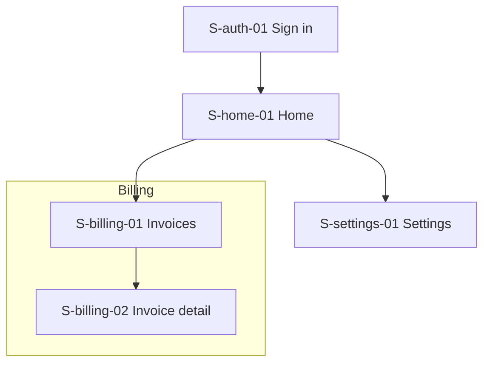

# Information architecture and screen map

<!-- IA first, navigation second. A first pass is enough to start flows and specs. Grounding: research/raw/ux--nngroup-ia-vs-navigation.md -->

Status: draft. Source: `../product-strategy.md` sections {list}.

## 1. Content and function inventory

| Object or function | What the user does with it | Journeys | Frequency (daily, weekly, rare) | Sensitive data |
|---|---|---|---|---|
| {Invoice} | {create, send, mark paid} | J-01, J-02 | weekly | {yes: amounts} |

## 2. Grouping

| Group | Contains | Why grouped (user mental model, not org chart) |
|---|---|---|
| {Billing} | {Invoices, Payments, Plans} | {Users describe these as "money stuff" in J-01} |

## 3. Controlled vocabulary

One term per concept. Every screen spec, prototype and message uses these exact words.

| Term | Means | Do not say |
|---|---|---|
| {Workspace} | {The shared container for a team} | {Org, Account, Tenant} |

## 4. Screen map

## 5. Navigation model

| Element | Pattern | Items | Rationale tied to section 1 frequency |
|---|---|---|---|
| Global | {sidebar, top bar, tab bar} | {list} | {why} |
| Local | {tabs, segmented control} | {list} | {why} |
| Utility | {account menu, help} | {list} | {Help sits in the same place on every screen: WCAG 3.2.6} |

## 6. Key screens to prototype

Pick the screens on the critical path of the highest-value journeys. Usually 4 to 8.

| Screen ID | Why it is key | Journeys | Flows |
|---|---|---|---|
| {S-home-01} | {first value moment} | J-01 | F-01 |
