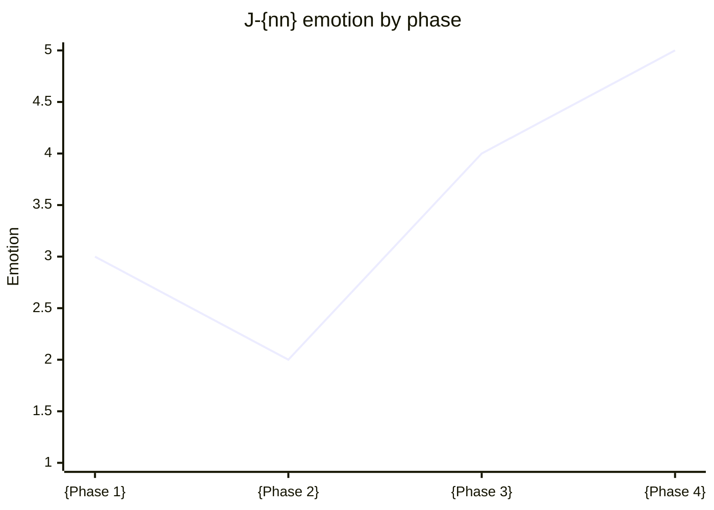

# J-{nn}: {Actor} wants to {goal}

<!-- One actor per map. A journey covers time or channels; step-by-step screen interactions belong in a task flow (F-ids). Grounding: research/raw/ux--nngroup-journey-mapping-101.md, ux--nngroup-journeys-vs-flows.md -->

| Field | Value |
|---|---|
| Actor | {Persona or segment name from product-strategy.md, quoted with its section} |
| Scenario | {The situation that starts this journey} |
| Expectations | {What the actor expects to be true at the end} |
| Strategy link | {Section of product-strategy.md this journey serves} |
| Evidence | {interview, analytics, support tickets, or "assumption" when none} |
| Status | draft |

## Phases

| Phase | {Phase 1} | {Phase 2} | {Phase 3} | {Phase 4} |
|---|---|---|---|---|
| Actions | {What they do, in narrative steps} | | | |
| Mindset | {Questions and information needs in their words} | | | |
| Emotion (1 low to 5 high) | {n, with a five-word reason} | | | |
| Touchpoints | {Channel or screen IDs, for example S-onboarding-01} | | | |
| Pain points | {What goes wrong today, or "unknown"} | | | |

## Emotion line

<!-- If xychart is unsupported where this renders, keep the table row and delete this block. -->

## Opportunities

| # | Opportunity | Phase | Owner | Metric that shows it worked | Leads to |
|---|---|---|---|---|---|
| 1 | {How the product removes a pain point} | {phase} | {role} | {measurable signal} | {F-id or S-id} |

## Assumptions and open questions

- Q-{nn}: {What we do not know and how we would find out}
