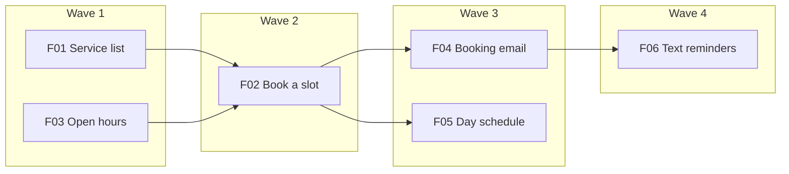

# Wave Plan: Tidy Bookings (worked example)

> **Status:** Approved
> **Revision:** 1
> **Approved by:** Example Owner on 2026-10-12
> **PRD Map:** [example-prd-map.md](example-prd-map.md) revision 1
> **Definition of Done:** `library/knowledge/private/standards/definition-of-done.md` revision 1

This is a made-up example. It passes `python3 scripts/check_wave_plan.py references/examples/example-wave-plan.md --prd-map references/examples/example-prd-map.md`.

## Wave table

| Key | PRD | Wave | Depends on | Why this wave |
|---|---|---|---|---|
| F01 | PRD-001 | 1 | None | Nothing to wait for; booking needs it |
| F03 | PRD-003 | 1 | None | Highest unknowns (slot rules), so it goes first |
| F02 | PRD-002 | 2 | F01, F03 | Needs services and slots; finishes the main journey |
| F04 | PRD-004 | 3 | F02 | Reads booking events |
| F05 | PRD-005 | 3 | F02 | Reads booking records |
| F06 | PRD-006 | 4 | F04 | Nice-to-have, so last |

## Wave 1: Services and open hours

- **Goal:** the groomer can list services and set open hours.
- **PRDs:** F01, F03
- **Entry criteria:**
  - [x] This plan revision is Approved by the owner.
  - [x] The Definition of Done revision above is Approved.
  - [ ] PRD-001 and PRD-003 exist in `library/requirements/backlog/` with acceptance criteria in the ID table format.
  - [ ] CTR records for B01 and B02 are accepted and pinned in PRD-001, PRD-002 and PRD-003.
- **Exit criteria:**
  - [ ] Every acceptance criterion in PRD-001 and PRD-003 is VERIFIED by a separate pass.
  - [ ] Both PRDs meet the project Definition of Done and their PRD checklists.
  - [ ] Security review, then quality review, report no open finding of medium severity or higher.
  - [ ] The provider checks for B01 and B02 pass.

## Wave 2: Book a slot (walking skeleton complete)

- **Goal:** a customer can book a slot without phoning (journey J1 steps 1 to 3).
- **PRDs:** F02
- **Entry criteria:**
  - [ ] Wave 1 exit criteria are all true.
  - [ ] The CTR for B03 is accepted and pinned in PRD-002, PRD-004, PRD-005 and PRD-006.
- **Exit criteria:**
  - [ ] Every acceptance criterion in PRD-002 is VERIFIED by a separate pass.
  - [ ] PRD-002 meets the project Definition of Done.
  - [ ] Security review, then quality review, report no open finding of medium severity or higher.
  - [ ] Consumer checks for B01 and B02 pass; a second booking for a taken slot is refused.

## Wave 3: Confirmation and day view

- **Goal:** both sides know about each booking.
- **PRDs:** F04, F05
- **Entry criteria:**
  - [ ] Wave 2 exit criteria are all true.
- **Exit criteria:**
  - [ ] Every acceptance criterion in PRD-004 and PRD-005 is VERIFIED by a separate pass.
  - [ ] Both PRDs meet the project Definition of Done.
  - [ ] Security review, then quality review, report no open finding of medium severity or higher.
  - [ ] Consumer checks for B03 pass.

## Wave 4: Reminders (nice-to-have)

- **Goal:** fewer missed appointments.
- **PRDs:** F06
- **Entry criteria:**
  - [ ] Wave 3 exit criteria are all true.
  - [ ] The owner confirms F06 is still wanted.
- **Exit criteria:**
  - [ ] Every acceptance criterion in PRD-006 is VERIFIED by a separate pass.
  - [ ] PRD-006 meets the project Definition of Done.
  - [ ] Security review, then quality review, report no open finding of medium severity or higher.

## Dependency graph

## Risks and assumptions

- Slot rules (F03) may need a time-zone decision. If so, B02 changes and F02 waits. Owner decides.

## Revision history

| Revision | Date | Change | Approved by |
|---|---|---|---|
| 1 | 2026-10-12 | First plan | Example Owner |
