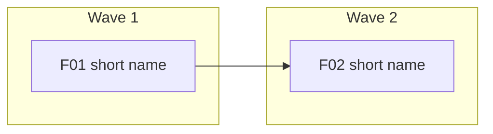

# Wave Plan template

> Copy to: `library/requirements/plans/wave-plan.md`
> Replace every `<placeholder>`. Delete these quote lines when done.
> Guide: [../../guides/04-plan-waves.md](../../guides/04-plan-waves.md)
> Check it: `python3 scripts/check_wave_plan.py <path-to-wave-plan.md> --prd-map <path-to-prd-map.md>`

---

# Wave Plan: <product name>

> **Status:** Draft | Approved
> **Revision:** <n>
> **Approved by:** <owner name> on <YYYY-MM-DD> | Not yet approved
> **PRD Map:** [prd-map.md](prd-map.md) revision <n>
> **Definition of Done:** `library/knowledge/private/standards/definition-of-done.md` revision <n>

## How to use this plan

`/smoke-it` and TARS read this file instead of making up their own order. Only an **Approved** revision may be executed. If the plan must change, raise a new revision and get approval again; do not edit an approved plan in place.

A wave starts only when its entry criteria are all true. A wave ends only when its exit criteria are all true. "Depends on" means the other PRD must be VERIFIED (not just done) first.

## Wave table

| Key | PRD | Wave | Depends on | Why this wave |
|---|---|---|---|---|
| F01 | PRD-<###> | 1 | None | <for example: thinnest end-to-end path; highest unknowns> |
| F02 | PRD-<###> | 2 | F01 | <needs F01's data shape> |

## Wave 1: <short name>

- **Goal:** <what a user can do when this wave is finished>
- **PRDs:** F01
- **Entry criteria:**
  - [ ] This plan revision is Approved by the owner.
  - [ ] The Definition of Done revision above is Approved.
  - [ ] Every PRD in this wave exists in `library/requirements/backlog/` with acceptance criteria in the ID table format.
  - [ ] Every shared boundary these PRDs use has an accepted CTR revision pinned in each PRD.
- **Exit criteria:**
  - [ ] Every acceptance criterion of every PRD in this wave is VERIFIED by a separate pass, not by the builder.
  - [ ] Every PRD in this wave meets the project Definition of Done and its own PRD checklist.
  - [ ] Security review, then quality review, report no open finding of medium severity or higher.
  - [ ] <wave-specific check, for example: a user can complete journey J1 end to end>

## Wave 2: <short name>

<repeat the block above>

## Dependency graph

Arrows point from the PRD that must finish first to the PRD that waits.

## Risks and assumptions

- <risk, what it would change in the plan, and who decides>

## Revision history

| Revision | Date | Change | Approved by |
|---|---|---|---|
| 1 | <YYYY-MM-DD> | First plan | <owner> |
