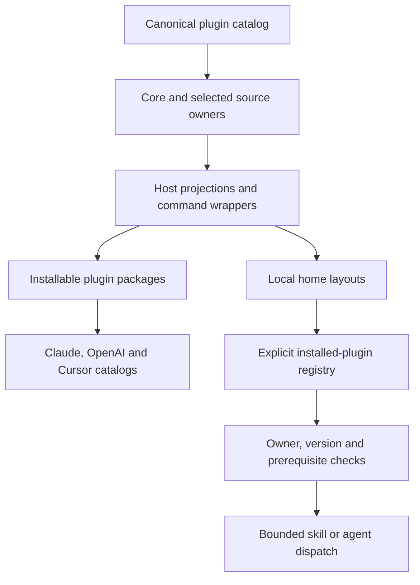

# Plugin Layout, Version 3

> Category: Plugins | Version: 3.1 | Date: October 2026 | Status: Active

For users choosing plugins and maintainers updating source, the approved layout has one required Core and twenty optional plugins. The canonical [catalog](../../plugin-catalog.json) records every skill, agent, command and prerequisite. The [source inventory](https://github.com/legioncodeinc/vibe-coding-tools#what-ships) lists their contents.

**Related:**

- [Harness capabilities](HARNESS-CAPABILITIES.md)
- Release process
- [Canonical catalog](../../plugin-catalog.json)
- [Source README](https://github.com/legioncodeinc/vibe-coding-tools#readme)

---

Core retains eighteen skills, fourteen agents and nine commands. Its permanent foundation includes Get Started, Library, Knowledge, Quality, Security and GitHub repository health. Across all twenty-one plugins, there are 223 canonical skills, 184 agents and seventy-seven source commands. Generated command-wrapper skills are adapters for those commands, not extra source capabilities.

## Why each capability has one owner

The old Core carried most specialists, while Audit Tools mixed public website work, repository inspection, documentation refresh and authenticated app capture. Those jobs have different inputs and access boundaries. The twenty-one-plugin layout groups related work and keeps shared gates in Core.

A specialist's agent and skill remain together. Supporting guides, templates, scripts, references and notices travel with that owner. The catalog names the canonical source location; generated copies adapt it to a host without becoming a second authoring source.

| Plugin | Skills | Agents | Commands | Canonical source |
| --- | ---: | ---: | ---: | --- |
| `wasp-nest-core` | 18 | 14 | 9 | `src` |
| `website-audit-tools` | 21 | 20 | 1 | `packs/website-audit-tools` |
| `code-audit-tools` | 12 | 11 | 1 | `packs/code-audit-tools` |
| `documentation-tools` | 8 | 8 | 3 | `packs/documentation-tools` |
| `web-development-tools` | 23 | 23 | 6 | `packs/web-development-tools` |
| `backend-and-desktop-tools` | 9 | 9 | 4 | `packs/backend-and-desktop-tools` |
| `data-and-ai-tools` | 12 | 12 | 3 | `packs/data-and-ai-tools` |
| `platform-and-release-tools` | 19 | 19 | 6 | `packs/platform-and-release-tools` |
| `growth-and-customer-tools` | 14 | 14 | 1 | `packs/growth-and-customer-tools` |
| `business-and-product-tools` | 12 | 12 | 5 | `packs/business-and-product-tools` |
| `media-and-creative-tools` | 3 | 3 | 1 | `packs/media-and-creative-tools` |
| `browser-and-app-testing-tools` | 4 | 4 | 1 | `packs/browser-and-app-testing-tools` |
| `highlevel` | 3 | 3 | 1 | `packs/highlevel` |
| `littlebird-toolkit` | 30 | 0 | 1 | `packs/littlebird-toolkit` |
| `content-intelligence` | 2 | 0 | 1 | `packs/content-intelligence` |
| `app-primer-zero` | 1 | 0 | 1 | `packs/app-primer-zero` |
| `developer-learning-tools` | 2 | 2 | 2 | `packs/developer-learning-tools` |
| `software-economics-tools` | 4 | 4 | 4 | `packs/software-economics-tools` |
| `infrastructure-decision-tools` | 2 | 2 | 2 | `packs/infrastructure-decision-tools` |
| `repository-modernization-tools` | 0 | 0 | 5 | `packs/repository-modernization-tools` |
| `product-studio` | 3 | 3 | 1 | `packs/product-studio` |

The immutable Core set is Get Started, Library, Knowledge, Quality, Security and GitHub repository health. The approved additions keep routing, creation, Git, dependency review, contracts, decisions, writing and harness integration available to every workflow.

## From source to an installed capability



`resolve_plugins` computes the required selection and orders unconditional prerequisites first. `build` reads each owner's current source, writes the host projections and emits the selected package list. `install.sh` copies those home layouts and records actual installed package roots.

The public staging generator copies the built plugin packages and produces the marketplace views, public README, learning tree and file-hash manifest. It performs local preparation; the release workflow handles publication after the owner's action.

## Installation selection

Purge the previous Wasp Nest installation before using this layout. There are no legacy aliases, aggregate Audit Tools package or command bridge.

- `--core-only` selects Core.
- `--packs website-audit-tools` selects Core, Browser and App Testing, then Website Audit.
- `--profile refresh-repository-knowledge` selects Core, Documentation and Code Audit.
- The default selects all twenty-one plugins.

The builder validates the selection before writing output. The installer copies each selected plugin's commands, command wrappers, skills and agent projections into the chosen home layouts. It records selected package roots in `~/.wasp-nest/installed-plugins.json`.

Source preparation does not run installation, publish a release or change a user's live harness.

## Shared ownership

Quality, shared Security, GitHub and dependency checks stay in Core. Website Audit owns external website methods, including the existing saved-site accessibility auditor. Code Audit owns repository, framework, polyglot and Lovable investigations. Browser and App Testing owns automation and authenticated capture. Documentation owns KB Refresh and Library Packets.

Full KB Refresh requires Code Audit's Swarm capability. Native Website Audit requires Browser and App Testing. Each capability keeps its original access and approval limits. A source or private-app accessibility request still needs a defined adapter; moving the website auditor does not add that coverage.

## Runtime prerequisites

Core's [resolver](../../hooks/resolve-component.py) checks the component owner, declared prerequisites, matching versions and the installed file. It reads the explicit installed-plugin registry. When that file is absent, it reads Claude Code's own install record (`~/.claude/plugins/installed_plugins.json`, or under `CLAUDE_CONFIG_DIR`) and selects only the plugins listed there from Core's own marketplace. It does not treat cached marketplace folders as enabled plugins.

For example, a registry contains actual installed roots:

```json
{
  "plugins": {
    "wasp-nest-core": "/actual/installed/core/root",
    "documentation-tools": "/actual/installed/documentation/root",
    "code-audit-tools": "/actual/installed/code-audit/root"
  }
}
```

These are placeholders, not proposed filesystem locations. The local installer writes real roots automatically. A native marketplace or UI install is not proven to populate this registry. For that route, ask the assistant to prepare the registry from the actual enabled plugin roots, review it before writing, and trust Core's hook before global Codex role registration. Without that setup, optional global Codex roles are not promised.

Core alone declares the shared lifecycle hooks. Its [role registrar](../../hooks/register-codex-agents.py) loads declared roles from the explicit selection, preserves customized files in backups, and refuses unsafe source or destination paths. Optional plugins carry role projections without duplicate registration hooks.

## Public packaging

The public generator produces separate Claude, OpenAI and Cursor marketplace files from the selected built plugins. OpenAI uses root `plugin.json` with `extensions.com.openai`; no competing Codex overlay is emitted. Cursor gets its own manifest and agent projection.

Public plugins omit raw research captures, bytecode caches and ingested photography records. Media ships the blank model template. Private originals from this migration are preserved in the ignored migration backup.

Builders refuse canonical source output locations and source symlinks. Publication checks its inputs before copying. Installation and role registration refuse symlink and traversal destinations.

The original proposal is historical approval evidence. Its temporary bridge was declined when the layout was approved. Current membership and behavior come from the catalog and source files above.
