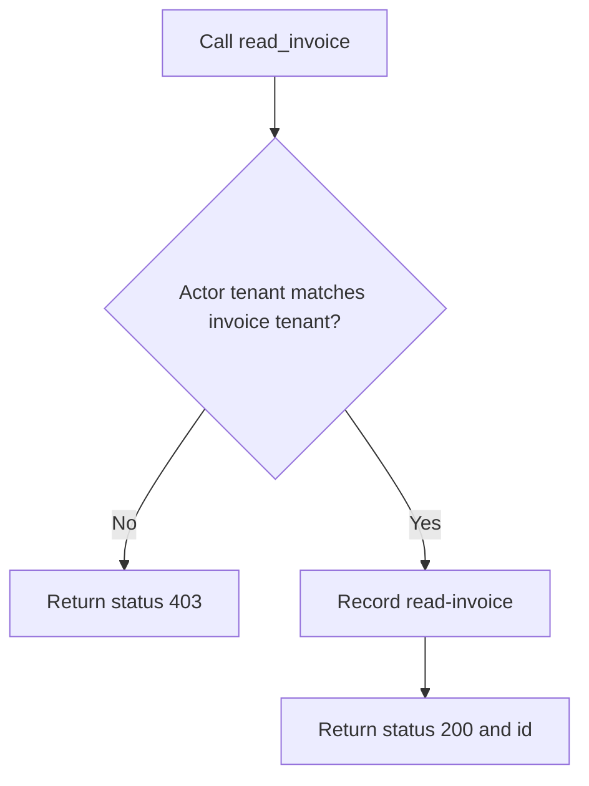
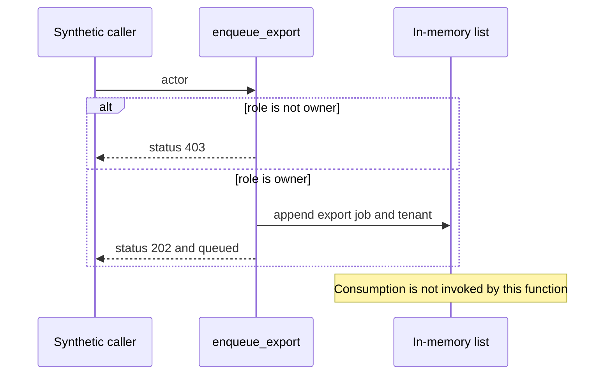
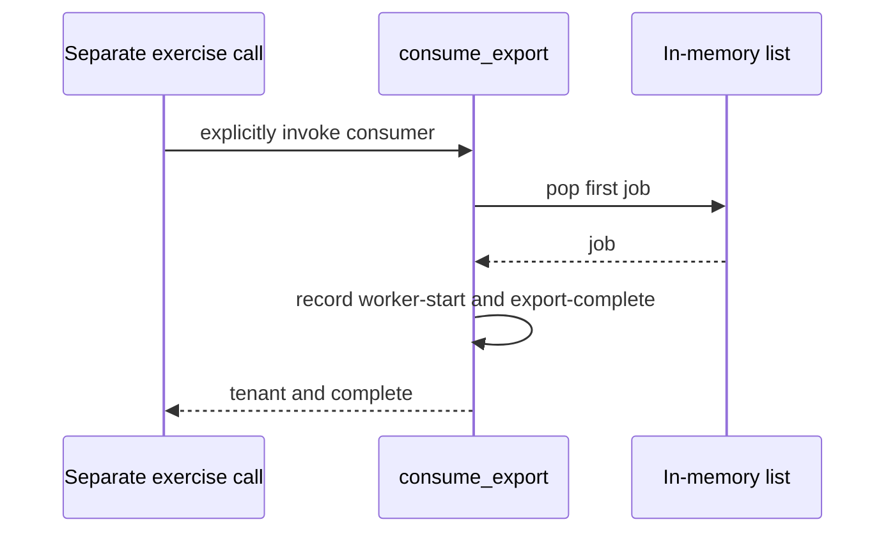
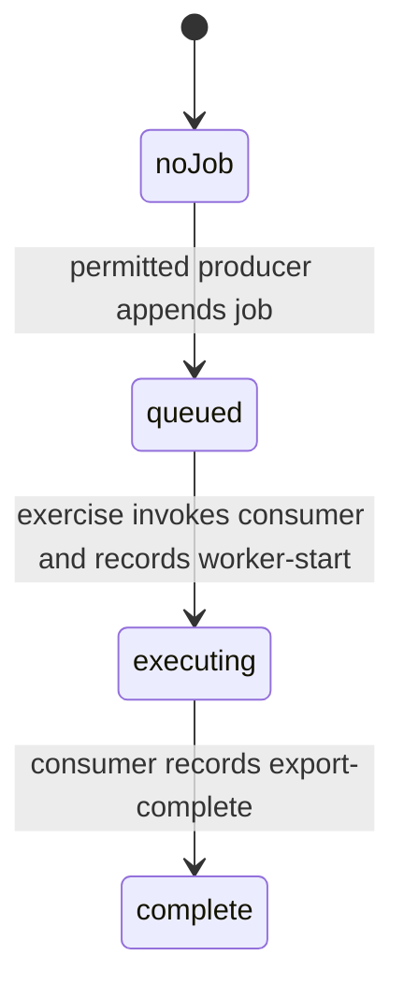
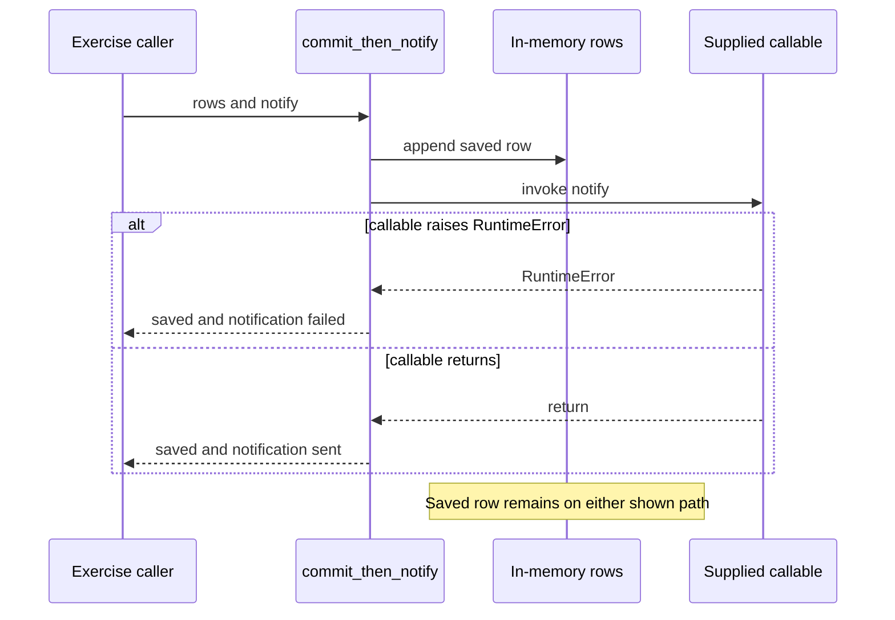

# Diagrams That Preserve the Teaching Source

> Category: Architecture | Version: 1.0 | Date: October 2026 | Status: Draft

For documentation authors, these completed teaching diagrams explain the local synthetic [source fixture](fixtures/flows.py), with exact quotes, hashes and eight observed Python exercises in the [receipts](receipts.json).

**Related:**
- [Source fixture](fixtures/flows.py)
- [Source and execution receipts](receipts.json)
- [Diagram procedure](../../../guides/06-preserve-behavior-in-diagrams.md)
- [Worksheet](../../templates/source-grounded-diagram.md)

---

## Why these cases exist

A diagram can parse correctly while reversing the source's behavior. These cases restore branches and state that a tidy happy-path picture can hide. They represent synthetic inspected and executed Python functions, not an implemented or deployed customer application. No Accepted requirement, real identity verifier, durable queue, SQL database, payment provider or live notification exists in this fixture.

The fixture SHA-256 and exact source quotes reside in `receipts.json`, rooted at this example directory. There is no remote source revision for this newly written fixture; its hash pins the bytes. The guide's research manifest separately captures the existing Core owner before its update. No diagram below grants authority to call a real system.

## A denied caller returns before reading

`read_invoice` compares the supplied synthetic actor and invoice tenant fields at lines 3-6. The forbidden branch returns immediately. Lines 7-8 execute only when the tenant strings match. In a real app, the source of the actor identity and the lookup scope would require additional evidence; this fixture does not establish those controls.

Legend: arrows describe control flow in this function. Terminal return nodes have no outgoing edge. The denial and permitted-read exercises confirm the two traces. A false diagram that connects `forbiddenReturn` to `invoiceRead` invents a read after the return. A node called authentication would also invent a check that the fixture never performs.

## A Draft intention does not change the current diagram

The [Draft teaching intention](fixtures/draft-teaching-intention.txt) requests owner-only invoice reads. The current `read_invoice` function contains no role check. The eighth exercise supplies a same-tenant member and receives status 200. Keep that result in the current diagram; label owner-only access as intended and unimplemented. Drawing a role gate inside the current flow would falsely imply the Draft request is enforced. This teaching note is not a real PRD, ADR or Accepted contract.

## Producer acceptance precedes a separate consumer

`enqueue_export` checks the synthetic role at lines 12-15, appends one job and returns queued at lines 16-18. `consume_export` is a separate function at lines 21-25. Nothing inside the producer automatically invokes it. The separate-consumer exercise calls it explicitly after the accepted-without-consumer exercise.

Legend: solid arrows represent fixture calls/list operations, dotted arrows returns. The diagrams separate the two invocations instead of implying automatic execution. An arrow from producer to consumer would need a real call locator. The list is not durable and has no delivery, retry, deduplication or empty-queue error handling. Rendering it with a queue icon would not add those mechanisms.

For this teaching sequence only, these state labels summarize the observed traces:

The transition to complete depends on the explicit consumer invocation. Denied producer calls remain at noJob. This is an exercise state summary, not a production worker state machine. Failure, retry and duplicate paths are unknown rather than fabricated.

## Persistence survives a later notification error

`commit_then_notify` appends a saved row before invoking the supplied `notify` callable. The exception branch catches `RuntimeError` and returns saved/failed without removing the row. This is a Python list exercise; the trace label `local-commit` does not prove a database transaction. No payment or entitlement operation occurs.

The failure exercise supplies a callable that raises. Its result is saved/failed and the row still exists. The success exercise returns normally and records notify-succeeded. A false picture that shows rollback after notification failure contradicts lines 29-35. A `critical` block enclosing both operations would not establish atomicity. Other exception types are not caught here and need their own path if that behavior is in scope.

## Check receipts and limitations

Eight local behavioral exercises passed: denied read, permitted read, denied enqueue, accepted producer with no consumption, explicit consumer completion, failed notification with retained row, successful notification, and a same-tenant member read that contradicts a Draft owner-role intention. Seven source claims preserve exact line ranges and quotes from the fixture hash. The ledger provides source proof for those behavior statements.

No `mmdc` executable is installed in this environment. Mermaid blocks received structural review only; local parser and visual rendering remain unverified. No package was installed and no diagram or source was sent to a hosted renderer. The published official syntax pages were consulted for notation. Their newer renderer features do not establish support in any consuming host.

A product diagram needs the real caller, entrypoint, code revision, enforced permissions, error paths and actual persistence/queue semantics. A screenshot alone cannot establish those facts. A reader's understanding also remains pending until their response.
