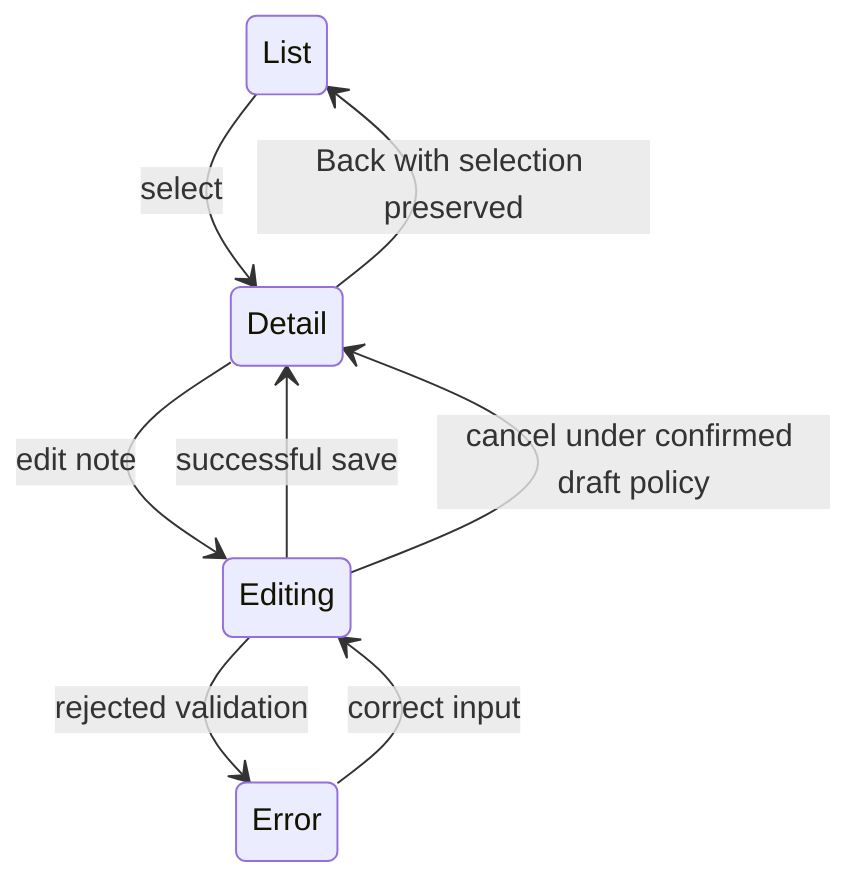

# Worked contract cases: O219 and O222

These are synthetic, unstyled source-review cases. They do not implement a product surface or demonstrate native/browser interaction. See [intake](../templates/product-system-intake.md), [primitive contract](../templates/primitive-acceptance-contract.md), [mobile flow contract](../templates/mobile-flow-acceptance.md).

## Case A: missing product direction

Input: “Use shadcn for a dashboard.” No PRODUCT.md, DESIGN.md, product-system folder, source code or user-task statement supplied.

Recorded output: framework=React requested; primitive family=unknown; task=unknown; tokens=unknown; existing visual authority=unknown. Request those missing inputs in one batch. Produce no theme, colors, spacing or new dashboard. O219 acceptance remains unproven. Actual design/build routes through Impeccable after context is resolved.

## Case B: copied Radix trigger loses behavior

Unstyled review fragment:

```tsx
const TaskAction = () => <button>Open task</button>
// Selected copied source composes this child via Radix asChild.
```

Observed source issue: the child accepts no passed props or ref. The current Radix composition reference requires both to reach the underlying node. This is a source-contract finding, not a tested browser failure. Record exact actual file/line when reviewing a real product; do not cite this fragment as product evidence.

Proposed contract: keep the product action's semantic button, accessible name, inherited handlers and ref. Select React19 ref-prop or legacy forwardRef syntax against the actual installed source/types. Product tokens and variants remain unknown until the brief supplies them. Require real open, Tab/Shift+Tab, Escape, inertness and return-focus exercises plus build/type evidence. A Base UI copied component needs its own source contract; this Radix prescription does not establish Base UI behavior.

## Case C: compact detail with keyboard and Back

Synthetic task statement supplied for this case only: “Edit a selected record's note, then return to the same selected record.” Product aesthetic and token names remain unknown.

| Step | Contract proposal for owner confirmation | Status |
|---|---|---|
| List to detail | selected record remains identifiable; navigation exposes return path | proposed |
| Edit note | label and current draft retained while keyboard opens | proposed |
| Validation error | invalid field named, error reachable, entered note retained | proposed |
| Close keyboard | action and focused field remain reachable | proposed |
| Save succeeds | show result; return to selected record using agreed focus destination | proposed |
| Back/cancel/resize | preserve or discard draft only by stated product rule | unknown |

A desktop screenshot squeezed to phone width proves none of these transitions. Required evidence: actual browser/device/version, virtual keyboard, touch, keyboard where supported, screen reader, zoom/reflow, measured target spacing, result/error traces and source revision. All are unproven here. The task sequence is a contract diagram, not approval to build or submit data.



## Case D: screenshot passes, flow remains unqualified

Input evidence: one compact screenshot with bottom action and note field. Missing keyboard-open state, Back behavior, focus order, accessible name, loading/error and device metadata. Result: visual observation only, behavior unproven. Retain the screenshot as evidence; request the missing actual traversals. Do not report a WCAG or native-conformance pass.
